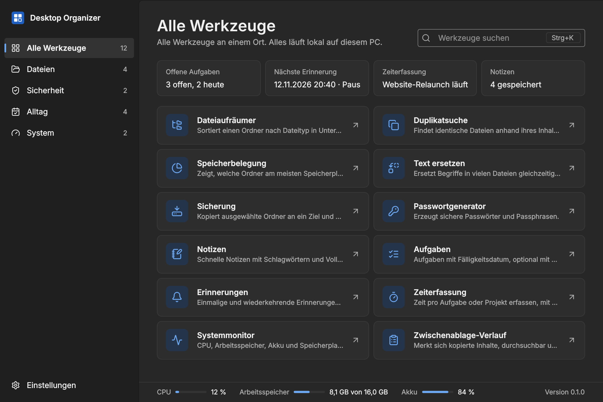
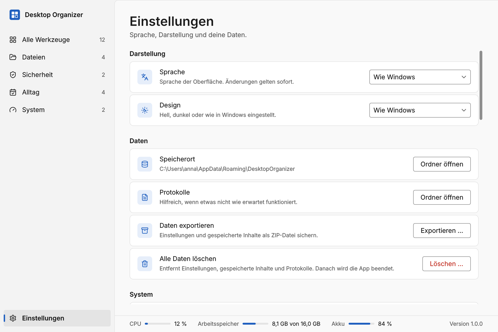

# Desktop Organizer

A local toolbox for Windows: file cleaner, duplicate finder, folder sizes, text replacer,
backup, password generator, notes, tasks, reminders, time tracker, system monitor and
clipboard history, in one quiet application. Everything runs on your computer; no account,
no telemetry, no network access.

**Status: 0.1.0, foundation.** The application shell, settings, storage, theming,
German and English UI and the build pipeline are in place. The tools follow in the next
milestones and are shown as "Not available yet" until then.


<details>
<summary>More screenshots</summary>




</details>

## Download

Releases are published on the repository's Releases page with:

- `DesktopOrganizer-<version>-setup.exe`: installer for the current user, no administrator rights needed
- `DesktopOrganizer-<version>-portable.zip`: unpack and run, data stays in the folder
- `SHA256SUMS.txt`: checksums to verify the downloads

The executables are not code-signed yet, so Windows SmartScreen asks for confirmation on first start. See [SECURITY.md](SECURITY.md).

## System requirements

- Windows 10 22H2 or Windows 11, 64-bit
- About 100 MB of disk space (download: installer 28 MB, portable ZIP 39 MB, measured for 0.1.0)

## Build from source

Requires Python 3.12 on Windows, and Inno Setup 6 for the installer.

```powershell
python -m venv .venv
.venv\Scripts\activate
pip install -r requirements-dev.txt

python -m desktop_organizer          # run from source (set PYTHONPATH=src or pip install -e .)
python -m pytest                     # tests
ruff check . ; mypy                  # lint and type check
python build/build.py                # dist\: portable ZIP, installer, SHA256SUMS.txt
python build/build.py --no-installer # without Inno Setup
```

GitHub Actions runs the same steps on every push (`.github/workflows/ci.yml`) and builds
the release on version tags (`.github/workflows/release.yml`).

## Documentation

- [User guide](docs/user-guide.md)
- [Design system](docs/design-system.md)
- [Architecture](docs/architecture.md)
- [Plan and decisions](docs/plan.md)
- [Roadmap](docs/roadmap.md)
- [Changelog](CHANGELOG.md)
- [Security notes](SECURITY.md)

## License

MIT, see [LICENSE](LICENSE). Icons: [Lucide](https://lucide.dev) (ISC license).
