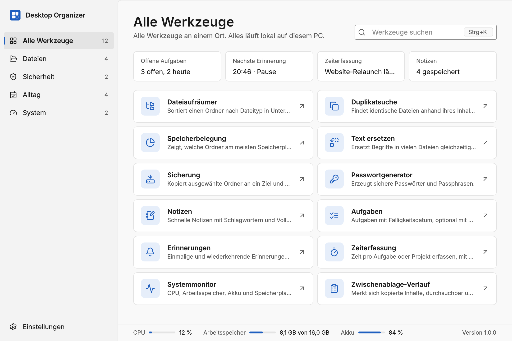
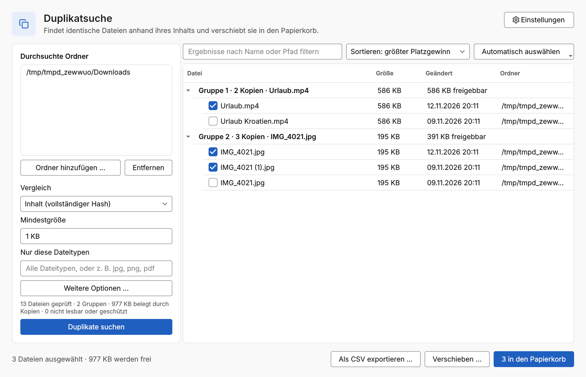
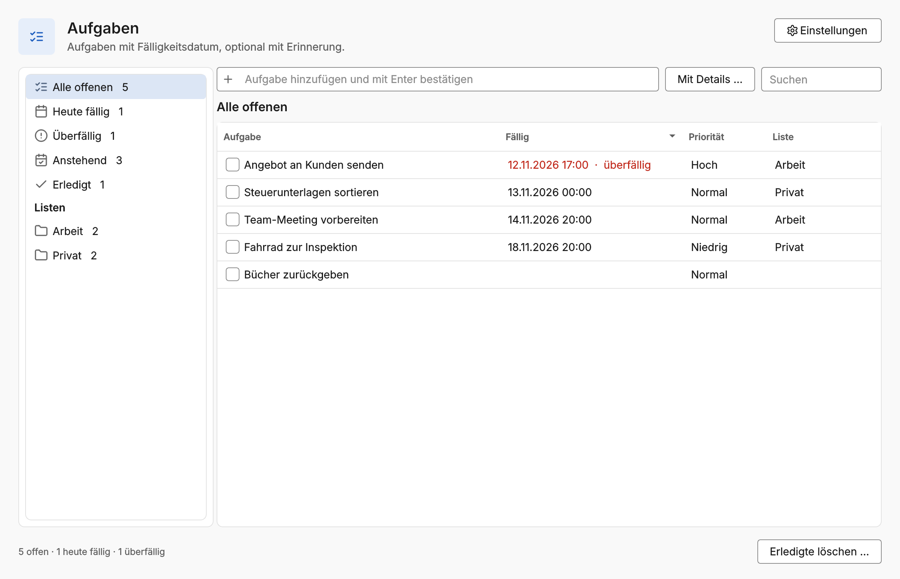
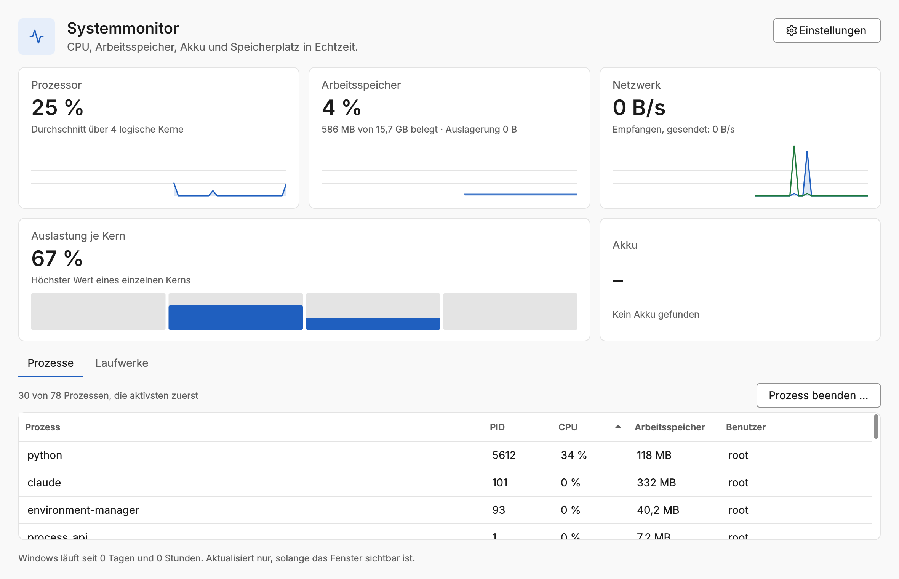
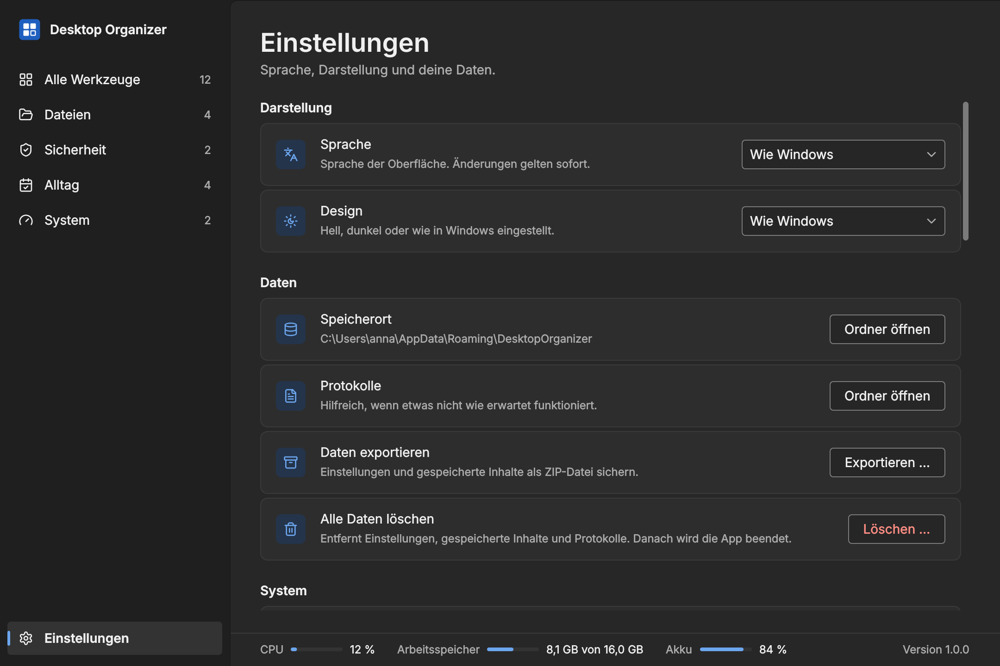

# Desktop Organizer

A local toolbox for Windows with twelve tools in one application: file cleaner,
duplicate finder, folder sizes, text replacer, backup, password generator, notes, tasks,
reminders, time tracker, system monitor and clipboard history. Each tool opens as its
own program window. Everything runs on your computer: no account, no telemetry, no
network access.



| | |
|---|---|
|  |  |
|  |  |

## Tools

| Tool | What it does |
|---|---|
| File cleaner | Sorts a folder into subfolders by type, optional year/month folders, preview, never overwrites, full undo |
| Duplicate finder | Several folders, content/fast/name comparison, filters, automatic keep rules, Recycle Bin or move, CSV report |
| Folder sizes | Drill-down folder sizes with share bars, largest files, file types, drive usage |
| Text replacer | Replace across many files with line preview, case/whole word/regular expressions, backup and undo |
| Backup helper | Profiles, incremental copy, mirror mode, verification, log and history |
| Password generator | Passwords and passphrases from a secure random source, strength meter, batch, clipboard auto-clear |
| Notes | Full-text search, tags, pinning, autosave, Markdown export |
| Tasks | Quick entry, due dates, priorities, lists, filters, linked reminders |
| Reminders | One-off and recurring reminders as Windows notifications, templates for breaks |
| Time tracker | Start/stop per project, week overview, manual entries, CSV export |
| System monitor | Live CPU, memory, network, cores, battery, drives and processes |
| Clipboard history | Optional, DPAPI-encrypted, skips password managers, search, pin, copy again |

Every tool has its own settings, reachable in the tool window and on the main settings page.

## Download and install

Releases provide:

- `DesktopOrganizer-<version>-setup.exe`: installs to `C:\Program Files\Desktop Organizer` with Start menu entry, desktop shortcut and uninstaller. Windows asks once for permission (UAC); the app itself runs with normal rights.
- `DesktopOrganizer-<version>-portable.zip`: unpack and run, data stays in the folder.
- `SHA256SUMS.txt`: checksums to verify the downloads.

The executables are not code-signed, so Windows SmartScreen asks for confirmation on first start. See [SECURITY.md](SECURITY.md).

## System requirements

- Windows 10 22H2 or Windows 11, 64-bit
- About 120 MB of disk space

## Build from source

Requires Python 3.12 on Windows and Inno Setup 6 for the installer.

```powershell
python -m venv .venv
.venv\Scripts\activate
pip install -r requirements-dev.txt

$env:PYTHONPATH = "src"
python -m desktop_organizer                  # main window
python -m desktop_organizer --tool notes     # a single tool
python -m pytest                             # tests
ruff check . ; mypy                          # lint and type check
python build/build.py                        # dist\: installer, portable ZIP, SHA256SUMS.txt
```

GitHub Actions runs the same steps on every push (`.github/workflows/ci.yml`) and builds the
release on version tags (`.github/workflows/release.yml`).

## Documentation

- [User guide](docs/user-guide.md)
- [Design system](docs/design-system.md)
- [Architecture](docs/architecture.md)
- [Plan and decisions](docs/plan.md)
- [Changelog](CHANGELOG.md)
- [Security notes](SECURITY.md)

## License

MIT, see [LICENSE](LICENSE). Icons: [Lucide](https://lucide.dev) (ISC). English passphrase
words: EFF Large Wordlist (CC BY 3.0 US); German words from a public domain dictionary
(see `src/desktop_organizer/resources/wordlists/SOURCES.txt`).
